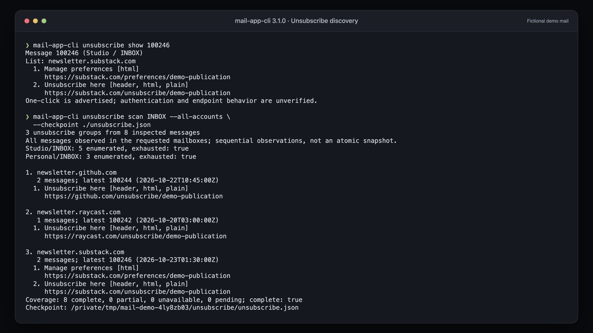
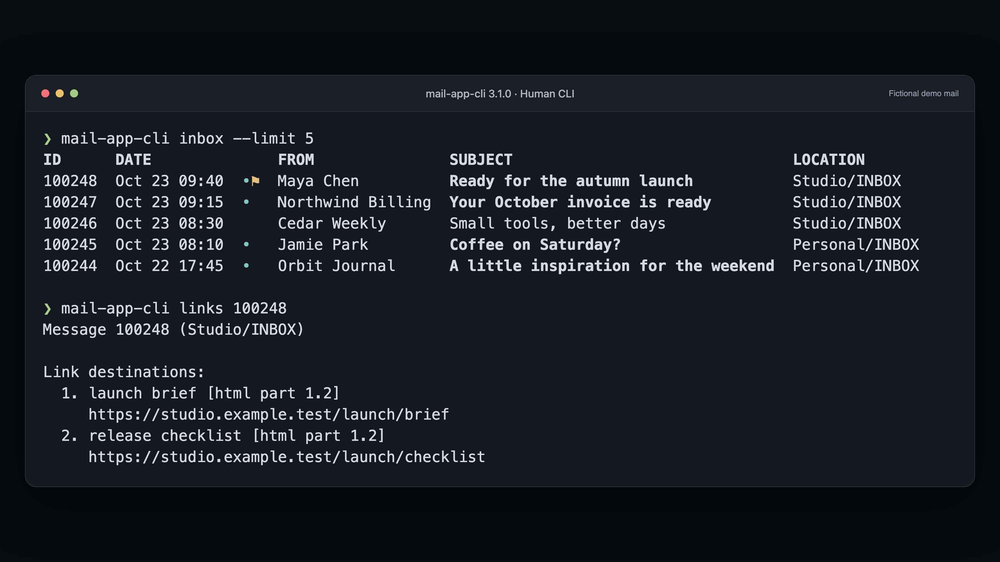
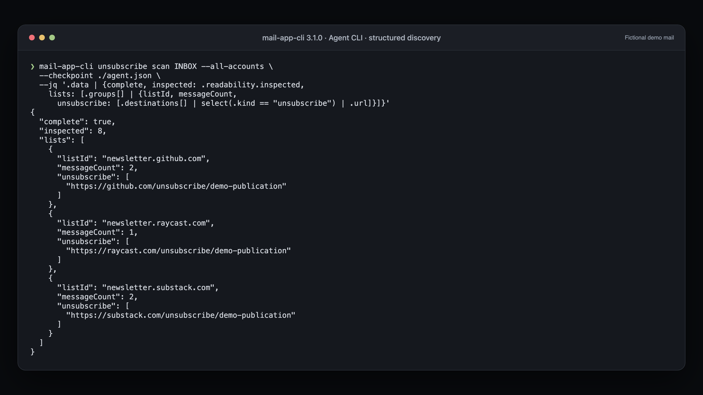
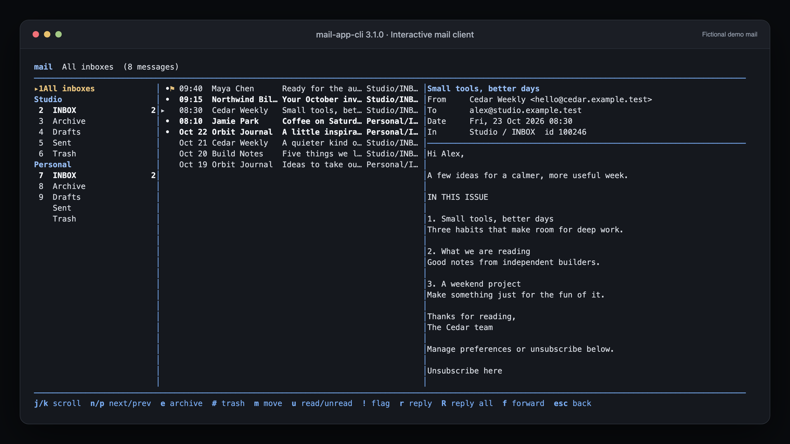

# Publication screenshots

Four separate, full-resolution PNGs for articles, release announcements, and social posts about mail-app-cli 3.1.0. Each image is **3200 × 1800 pixels (16:9)**. The terminal colors, text, and layouts come from the released CLI and TUI, with a consistent presentation frame.

All people, accounts, subjects, and bodies are fictional. The unsubscribe and agent examples use recognizable public domains from Substack, GitHub, and Raycast, with invented sender addresses, list identities, and demo URL paths. Those paths are illustrative. No private inbox content or personalized unsubscribe tokens are included. The human CLI and TUI examples use reserved `.example.test` domains. Every screenshot visibly identifies the mail as fictional.

| Image | Suggested caption | Files |
| --- | --- | --- |
| Human CLI | Triage messages across accounts and reveal the full destinations behind email links. | [PNG](../images/v3.1.0/human-cli.png) · [Text](../images/v3.1.0/human-cli.txt) |
| Agent CLI | Find unsubscribe opportunities with structured results, explicit coverage, and mailing-list groups. | [PNG](../images/v3.1.0/agent-cli.png) · [Text](../images/v3.1.0/agent-cli.txt) |
| TUI | Read and triage mail in a three-pane terminal client, with mailboxes, messages, and a reader. | [PNG](../images/v3.1.0/tui.png) · [Text](../images/v3.1.0/tui.txt) |
| Unsubscribe discovery | Inspect exact unsubscribe destinations, then scan inboxes and group opportunities without changing subscriptions. | [PNG](../images/v3.1.0/unsubscribe.png) · [Text](../images/v3.1.0/unsubscribe.txt) |

## Unsubscribe discovery



The example covers `unsubscribe show`, scanning both fictional accounts, list grouping, source evidence, complete local coverage, and a saved checkpoint. Advertised one-click metadata is shown without claiming that an endpoint has been verified. Discovery does not open URLs or unsubscribe.

## Human CLI



## Agent CLI



## TUI



The TUI image shows reading and triage. Unsubscribe destination discovery is demonstrated by the CLI images; the TUI reader does not currently expose those destinations.

## Regenerate

The fixture is [publication.json](../../scripts/fixtures/publication.json). Its `unsubscribeExamples` overrides supply the public-domain examples for the unsubscribe and agent images; the human CLI and TUI retain the original fictional senders. The capture script runs the installed **3.1.0** binary against a disposable SQLite index and local MIME files. A fixture-only automation shim provides fictional account inventory and read-only message metadata; unsupported automation calls fail. Real Mail automation is never invoked. The TUI runs in a separate tmux server, and its terminal output is captured directly.

Captured ANSI output is rendered locally with Chromium, using macOS Menlo and a window frame. No output values are rewritten. Companion text files provide accessible copies of the same content. Temporary checkpoint paths vary between runs.

Requirements: macOS, mail-app-cli 3.1.0, tmux, and Python 3.10 or newer. From the repository root:

```sh
python3 -m venv /tmp/mail-publication-venv
/tmp/mail-publication-venv/bin/pip install -r scripts/requirements-publication.txt
/tmp/mail-publication-venv/bin/python -m playwright install chromium
/tmp/mail-publication-venv/bin/python scripts/publication_screenshots.py
```

Use `--binary /absolute/path/mail-app-cli` to select a different installation of 3.1.0. Generated images and text files are saved in `docs/images/v3.1.0/`. Fixture files are retained in the reported temporary directory for inspection.
